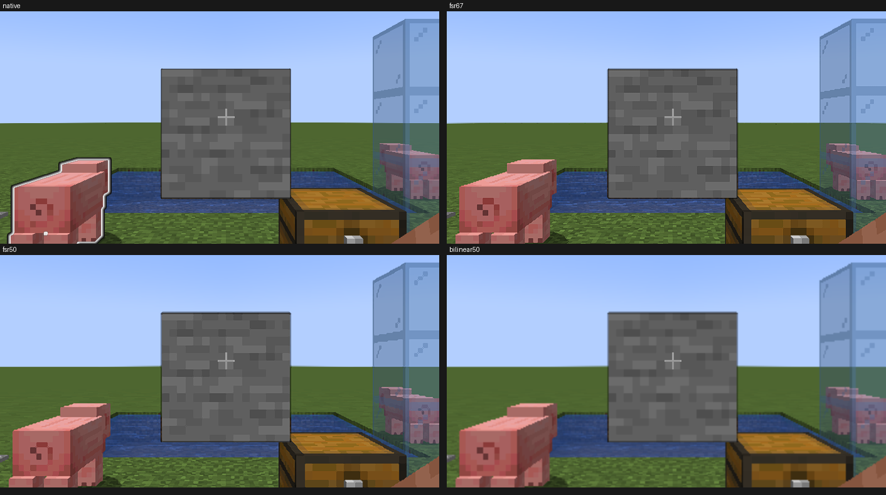

# Pocket FSR

Mod Fabric cho **Minecraft 1.21.1** giúp tăng FPS trên điện thoại / máy tính bảng (iOS, Android) bằng cách
**render thế giới 3D ở độ phân giải thấp hơn rồi nâng lên bằng FSR 1.0**, còn giao diện (thanh hotbar, chat, menu)
vẫn vẽ ở độ phân giải gốc nên chữ vẫn nét.

> A Fabric mod for Minecraft 1.21.1 that draws the 3D world at a lower resolution and upscales it with an
> FSR 1.0 style filter (EASU + RCAS) written in plain OpenGL. The GUI stays at native resolution.
> No native libraries and no Vulkan, so it can run through the GL translation layers used by mobile launchers.

**Trạng thái: thử nghiệm.** Mỗi lần push, GitHub Actions chạy thật game 1.21.1 với mod trên Linux (OpenGL phần mềm),
dựng thế giới thử, chụp ảnh khi tắt/bật upscale và kiểm tra không có lỗi GL (xem mục *Kiểm thử tự động*). Tuy nhiên mod
**chưa được thử trên iPhone/iPad/Android thật** (qua lớp dịch GL của launcher di động như MobileGlues, GL4ES...), nên có thể
còn lỗi riêng của thiết bị. Nếu bị lỗi, gửi file `logs/latest.log` ở trong issue.



*Ảnh chụp tự động từ CI (Mesa phần mềm): trên trái là gốc, trên phải FSR 1.0 ở 67%, dưới trái FSR 1.0 ở 50%, dưới phải Bilinear 50%.
Ở bản gốc mob "phát sáng" có viền trắng; viền này không được vẽ khi bật upscale (xem Giới hạn).*

## Cài đặt

1. Cài Fabric Loader cho 1.21.1 và [Fabric API](https://modrinth.com/mod/fabric-api).
2. Tải file `.jar` ở mục **Releases** và bỏ vào thư mục `mods`.

## Cách dùng

- Trong game, vào **Tạm dừng (Esc)** hoặc **Cài đặt video**: có nút **Pocket FSR** ở góc trên bên trái.
- Phím tắt: `F7` bật/tắt, `F8` mở màn hình cài đặt (đổi được trong Điều khiển).
- File cấu hình: `config/pocketfsr.json`.

| Tùy chọn | Ý nghĩa |
|---|---|
| Tỉ lệ render thế giới | 25% – 100%. Gợi ý: 67% (Quality), 59% (Balanced), 50% (Performance), 33% (Ultra Performance) |
| Phương pháp | `FSR 1.0` (đẹp hơn) hoặc `Bilinear` (nhanh nhất) |
| Độ sắc nét | RCAS, 0% = tắt |

## Giới hạn đã biết

- Đồ họa **Fabulous** chưa hỗ trợ: mod tự tắt, hãy dùng Fast hoặc Fancy.
- **Iris** / shader pack: không tương thích, mod tự tắt.
- Viền phát sáng (hiệu ứng Glowing, mũi tên Spectral, viền người chơi ở chế độ spectator) **không được vẽ** khi đang nâng độ phân giải:
  game vẽ viền vào một target riêng cỡ cửa sổ, không khớp với target nhỏ. Thực thể vẫn hiển thị bình thường.
- FSR 1.0 chỉ là lọc không gian (không dùng dữ liệu các frame trước), nên ở tỉ lệ rất thấp ảnh sẽ mềm.
- Chỉ dành cho 1.21.1.

## Cách hoạt động

```
GameRenderer.renderLevel  (mixin)
   ├─ HEAD:   thay "main render target" bằng một target nhỏ hơn → thế giới được vẽ ở độ phân giải thấp
   └─ RETURN: trả target thật về, chạy shader FSR (EASU → RCAS) từ ảnh nhỏ lên target thật
GUI được vẽ sau đó ở độ phân giải gốc
```

Hai mixin phụ giữ cho khung hình đúng khi target nhỏ đóng vai "main target":

- `RenderTarget.bindWrite`: khi bind target nhỏ thì luôn đặt lại viewport. Nếu không, sau khi game xóa target viền phát sáng
  (cỡ cửa sổ), viewport bị để ở cỡ cửa sổ và nước, mây, tay, khung chọn block bị phóng to / cắt mất.
- `LevelRenderer.shouldShowEntityOutlines`: tắt viền phát sáng trong khung hình được upscale.

Shader nằm ở `src/client/resources/assets/pocketfsr/shaders/core/` (GLSL 1.50, không dùng `textureGather`
nên chạy được trên các lớp dịch GL của launcher di động).

## Kiểm thử tự động

`.github/workflows/smoketest.yml` chạy game thật dưới Xvfb + Mesa (OpenGL phần mềm), tạo thế giới phẳng có sẵn một cảnh thử
(khối đá đang nhắm vào, nước, kính màu, rương, mob, bầu trời và mây), rồi chụp ảnh ở các chế độ: gốc, FSR 67%, FSR 50%,
Bilinear 50% và nhìn lên trời. Kết quả (ảnh + log) được đăng ở pre-release `ci-smoke`. Test sẽ lỗi nếu mixin không áp dụng được,
shader không biên dịch được hoặc có lỗi GL.

Lỗi nhìn thấy được (như tay bị mất, khung block lệch) là loại lỗi mà test này bắt được; lỗi chỉ xảy ra trên GPU/lớp dịch GL
của thiết bị di động thì không.

## Build

```sh
./gradlew build      # cần JDK 21 trở lên; file jar nằm ở build/libs/
```

GitHub Actions (`.github/workflows/build.yml`) tự build mỗi lần push. Để tạo bản phát hành:

```sh
git tag v0.1.0
git push origin v0.1.0     # workflow release.yml sẽ tạo Release kèm file jar
```

## Tạo mod Fabric trên GitHub (tóm tắt)

1. Vào <https://github.com/FabricMC/fabric-example-mod> → **Use this template** → tạo repo của bạn.
   Chọn nhánh đúng phiên bản Minecraft (ví dụ `1.21.1`); thông số phiên bản tra ở <https://fabricmc.net/develop>.
2. Đổi `modid`, tên gói Java, `fabric.mod.json`, `gradle.properties`, `settings.gradle` cho khớp mod của bạn.
3. Viết code trong `src/main/java` (chung) và `src/client/java` (chỉ client); mixin khai báo trong file `*.mixins.json`.
4. Push lên GitHub: Actions sẽ tự chạy `./gradlew build` và lưu file jar ở mục Artifacts.
5. Gắn tag `vX.Y.Z` để tạo Release có sẵn file jar cho người khác tải.

## Giấy phép và ghi công

- Mã nguồn của dự án: **GPL-3.0-or-later** (xem `LICENSE`).
- Ý tưởng thay render target trước khi vẽ thế giới và upscale trước khi vẽ GUI dựa theo mod
  [Super Resolution](https://github.com/IReallyWantToSleep/superresolution) của 187J3X1-114514 (GPL-3.0). Pocket FSR là bản viết lại
  nhỏ gọn, không dùng thư viện native, nhắm tới thiết bị di động.
- Thuật toán FSR 1.0 (EASU, RCAS) của **AMD FidelityFX**, giấy phép MIT: xem `LICENSE-FSR.txt`.
- Minecraft là sản phẩm của Mojang Studios / Microsoft. Dự án này không liên kết với họ.
